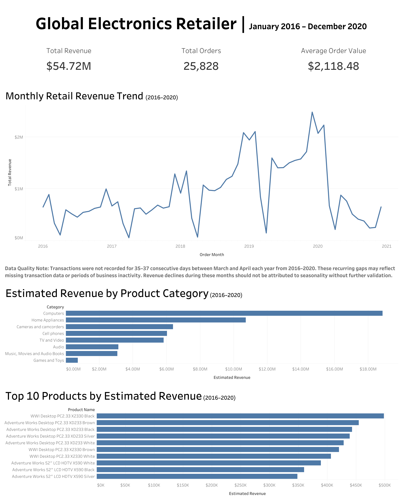

# Global Electronics Retailer — Sales Performance Analysis

**SQL (PostgreSQL) · Tableau Public · Data Validation · Business Analysis**  
**Reporting period:** January 2016 – December 2020

**Live Dashboard:** [View Interactive Tableau Dashboard](https://public.tableau.com/views/Book1_17931364262630/RetailSalesPerformanceDashboard)

## Dashboard Preview

## Project overview

This portfolio project analyzes transaction-level data from a fictitious global electronics retailer. The goal is to evaluate estimated sales performance, identify leading categories and products, assess order volume and average order value, and investigate whether observed revenue patterns are supported by sufficiently complete transaction coverage.

The original `Sales` table contains **62,884 transaction line items**. Dashboard metrics focus on **2016–2020**, excluding partial 2021 records for more consistent annual comparisons.

## Key performance indicators (2016–2020)

| Metric | Result |
| --- | ---: |
| Estimated sales value | **~$54.72 million** |
| Unique orders | **25,828** |
| Average order value | **$2,118.48** |
| Highest estimated-revenue category | **Computers** |
| Computers estimated sales value | **$18,855,849.81** |
| Computers units sold | **43,169** |

*Revenue figures are based on `Sales.Quantity × Products.Unit Price USD` and should be interpreted as **estimated sales value**, not validated net revenue.*

## Business questions

1. How did estimated monthly revenue change from 2016 to 2020?
2. Which categories and individual products generated the most estimated revenue?
3. Were steep monthly declines associated with fewer orders, changes in average order value, or both?
4. Are there transaction coverage gaps that could distort the interpretation of monthly performance?

## Tools and workflow

- **PostgreSQL 17, Docker, pgAdmin 4:** Imported relational CSV tables and ran analytical SQL queries.
- **SQL:** Used joins, CTEs, `DATE_TRUNC`, grouped aggregations, `COUNT(DISTINCT)`, `LAG`, date arithmetic, and referential-integrity checks.
- **Tableau Public:** Built KPI views, a monthly revenue line chart, a category revenue ranking, and a top-ten product ranking.
- **VS Code / GitHub:** Organized SQL scripts, documented data checks, and summarized insights.

**Data pipeline:** Source CSVs → PostgreSQL tables → validated SQL aggregates → exported CSVs → Tableau Public dashboard.

## Highlights

**Computers led category sales.** During 2016–2020, Computers generated approximately **$18.86M** in estimated sales value from **43,169 units sold**. Home Appliances followed at approximately **$10.72M**.

**Order volume was closely associated with the 2019 spring revenue decline.** Orders fell from **967 in February 2019** to **386 in March** and **75 in April**, while average order value was comparatively stable from February to March (**$2,174.63 → $2,191.52**) before decreasing in April (**$1,998.57**).

**Transaction gaps qualify the seasonal interpretation.** SQL date-gap analysis identified recurring stretches of **35–37 consecutive days without recorded sales** between March and April in **each year from 2016–2020**. These are gaps in recorded activity, **not confirmed missing transactions**. Business or source-data validation would be necessary before concluding that customer demand was seasonal.

For the detailed analysis, see [`reports/business_findings.md`](reports/business_findings.md).

## SQL analyses

The `sql/` directory contains these analyses (or will contain them as you finish organizing your locally saved scripts):

| SQL file | Purpose |
| --- | --- |
| `top_products_by_revenue.sql` | Top ten products by estimated sales value |
| `revenue_by_category.sql` | Category-level units sold and estimated sales value |
| `monthly_revenue.sql` | Monthly revenue time series |
| `monthly_revenue_growth.sql` | Month-over-month growth using `LAG()` |
| `monthly_orders_aov.sql` | Monthly order volume and average order value |
| `sales_date_coverage.sql` | First/last activity dates and active days by month |
| `transaction_gap_analysis.sql` | Longest periods without recorded transactions |
| `data_validation.sql` | Unmatched key checks and exchange-rate duplication checks |

## Data checks and limitations

- Checked `sales` references against `products`, `customers`, and `stores`; **0 unmatched sales rows** were reported for each relationship.
- The source contains repeated line items per order; unique orders use `COUNT(DISTINCT order_number)`.
- Product prices are supplied in USD as text and cleaned into numeric values for analysis.
- The estimated sales value calculation does not verify transaction-level historical prices, discounting, returns, or recognized accounting revenue.
- March–April revenue declines coincide with extended periods without recorded transactions; the root cause remains **unknown**.
- Reporting excludes partial-year 2021 records, but this does **not** establish that all 2016–2020 months have complete coverage.
- Tableau sheets use separate aggregated CSV exports; cross-source date filtering is not automatically synchronized.

## Data source and attribution

**Global Electronics Retailer**, Maven Analytics Data Playground; source attributed by Maven to **Microsoft**, license listed as **Public Domain**.  
Dataset: https://mavenanalytics.io/data-playground/global-electronics-retailer

Data represent a **fictitious retailer**. Any recommendations are illustrative and should not be treated as decisions for an actual business.

## Viewing the dashboard

After publishing, replace the placeholder above with your Tableau Public URL. Consider adding one final screenshot to `dashboard/dashboard_overview.png` and linking it here.

## Suggested next analysis

Extend the project to compare store/channel performance, verify whether reporting gaps correspond to known closures, and assess the effect of using static product USD prices rather than actual transaction-level amounts.
